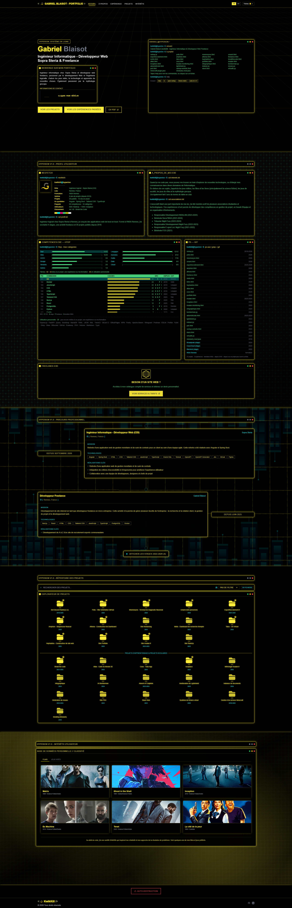

# Hyperion

Hyperion is my portfolio project. The goal of this project is to create a simple and easy to use portfolio website that showcases my work and skills. The website is built using Vue.js, Tailwind and pinia and is designed to be responsive and mobile-friendly.

Two versions of the website are available: a classic version and a cyberpunk version. The classic version is designed to be simple and elegant, while the cyberpunk version is designed to be more colorful and futuristic (and a bit more fun to work on). The website is also available in both English and French.

## cyberpunk version

## classic version

